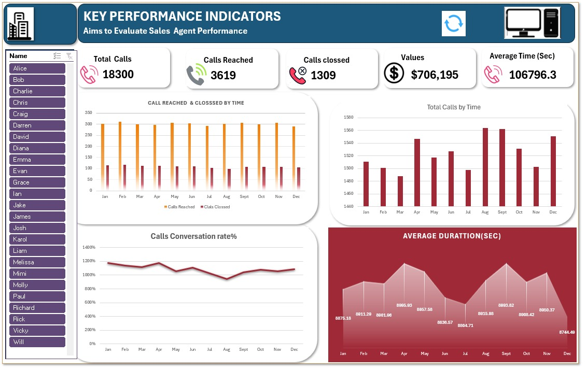

# Sales Agent Performance Dashboard

An interactive dashboard for monitoring and evaluating sales agents'
performance using key performance indicators (KPIs), monthly call
activity, sales value, and call-duration trends.



## Project Overview

This project presents a sales performance dashboard designed to help
users monitor sales activity and compare performance across agents and
months. A name filter allows users to focus on an individual sales
agent, while KPI cards and charts provide a summary of overall
performance.

The dashboard screenshot displays the following headline figures:

  KPI                    Value shown
  -------------------- -------------
  Total Calls                 18,300 <br>
  Calls Reached                3,619 <br>
  Calls Closed                 1,309 <br>
  Value $ 706,195 <br>
  Average Time (Sec)       106,796.3 <br>

*These are the values visible in the supplied dashboard screenshot; they
may change when the underlying dataset or filters change.*

## Dashboard Features

-   **Agent filtering:** Select an agent by name to focus the dashboard
    on their performance.
-   **KPI summary:** View total calls, calls reached, calls closed,
    sales value, and average time.
-   **Monthly call activity:** Compare calls reached and calls closed
    across January to December.
-   **Total calls trend:** Review the monthly distribution of total
    calls.
-   **Conversation-rate trend:** View the monthly conversation-rate
    measure presented in the dashboard.
-   **Average-duration trend:** Compare the displayed average call
    duration across the months.

## Key Performance Indicators

-   **Total Calls:** Overall number of calls recorded.
-   **Calls Reached:** Number of calls in which contact was made.
-   **Calls Closed:** Number of calls recorded as closed.
-   **Values:** Sales value represented in the dashboard.
-   **Average Time (Sec):** Average-time measure displayed by the
    dashboard. Confirm the aggregation and unit in the source workbook
    or data dictionary before interpreting it.

## Dataset

**Dataset link:** <a href = "C:/Users/Vincent/Downloads/Power BI/Dataset_Sales_Agents.xlsx"> Click Here </a>

### Suggested data fields

The dashboard indicates that the underlying data includes or supports
these dimensions and measures:

-   Sales agent name
-   Month or call date
-   Total calls
-   Calls reached
-   Calls closed
-   Sales value
-   Call duration / average duration
-   Conversation-rate measure

This is an inferred list based on the visualisations, not a verified
dataset schema. Update it to match the actual dataset column names.

## Tools and Technologies

The exact software and technologies used to build this dashboard were
not Microsoft Excel and Power BI.

## How to Use

1.  Clone or download this repository.
2.  Open the dashboard file using the application it was built with.
3.  Connect or load the source dataset if it is not already embedded.
4.  Use the agent-name filter to select an individual sales agent.
5.  Review the KPI cards and monthly charts to explore performance.

## Repository Contents

``` text
.
├── README.md
├── Dashboard.jpeg
└── [dashboard file and dataset to be added]
```

Update this structure to reflect the actual files committed to the
repository.

## Notes and Data Considerations

-   The figures shown in the screenshot are illustrative of the
    dashboard's current view and should not be treated as verified
    business results without checking the source data.
-   Confirm the definitions and calculation formulas for "Calls
    Reached," "Calls Closed," "Conversation rate," "Values," and
    "Average Time" in the underlying workbook or project documentation.
-   Check the unit and aggregation used for the average-time KPI. The
    screenshot shows `106796.3` in the KPI card, while the monthly
    duration chart displays values around 8,700--8,900; the difference
    should be explained by the source calculations before drawing
    conclusions.
-   Do not publish confidential customer, employee, or business data.
    Share only datasets that you are authorised to make public.

## Author

**Vincent MUNYANEZA**
Call/ Whatsapp: +250782467855/ 0728428416 <br>
Email: munyaneza20100@gmail.com <br>
https://www.linkedin.com/in/vincent-munyaneza-56390926a/
